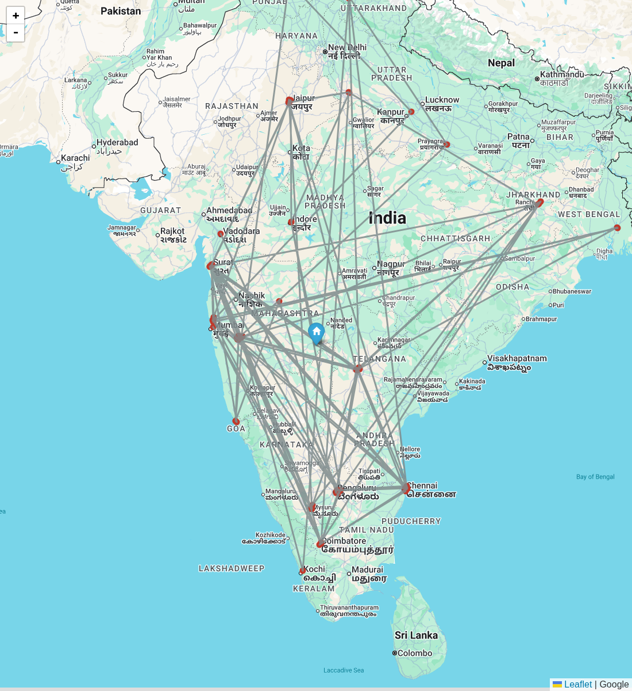
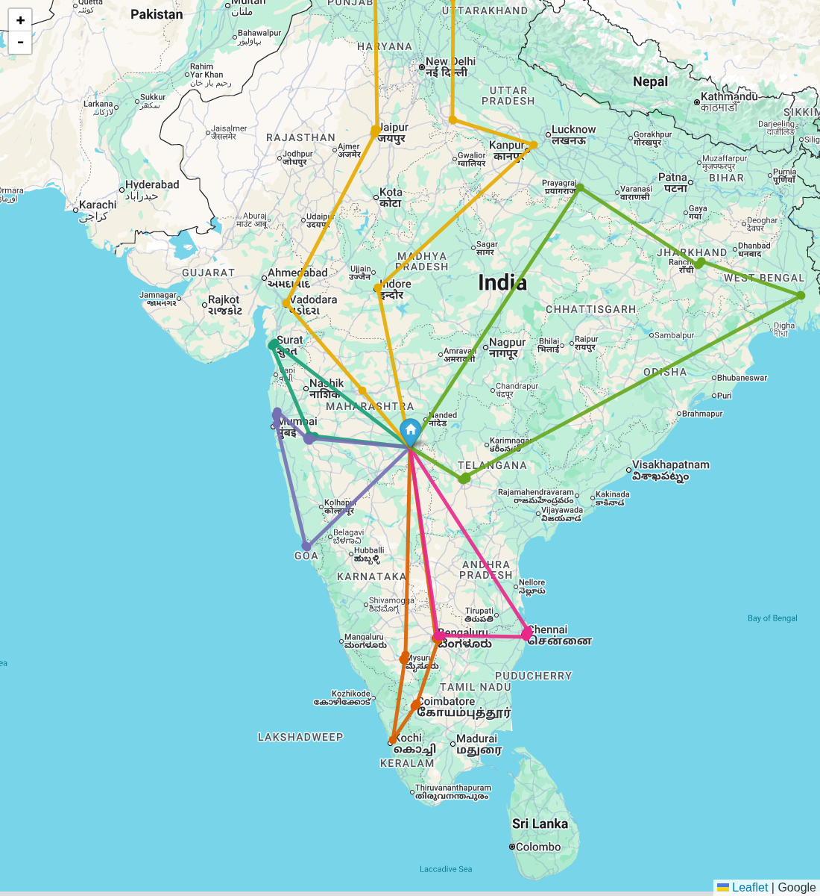

# Amazon Last-Mile Delivery Optimizer

  
  
   

*Left: the 90 cleaned stops in their original order, starting and ending at the depot (45,517.9 miles). Right: the same stops routed by OR-Tools, 6 vans, at most 15 stops each (7,858.1 miles).*

### Results (first 100 orders, 90 stops after cleaning)

| Metric | Before | After |
| --- | --- | --- |
| Total distance | 45,517.9 miles | 7,858.1 miles |
| Miles saved | — | 37,659.8 miles (**82.7%**) |
| Vans used | 1 tour, original order | **6** |
| Stops per van | single uncapped tour | **15** customer stops |
| Estimated annual cost impact | — | **$16,494,992.40** |

Both distances are geodesic miles on the same 90 stops and the same depot. Both totals include the return to the depot.

Annual cost impact uses the project's stated assumption of $1.20 per mile (fuel, driver, and wear) and 365 days:

`37,659.8 miles × $1.20 × 365 = $16,494,992.40`

The 100 orders fall on 40 dates (2022-02-11 through 2022-04-05), so this is that assumption applied to the sample.

### How it works

1. Load the first 100 orders from `amazon_delivery.csv`.
2. Drop the 10 stops whose coordinates are near (0, 0), in the Gulf of Guinea. Those are null-island GPS failures: the store coordinate is exactly (0, 0). They are removed before either distance is computed.
3. Place one depot at the average latitude and longitude of the remaining stops. The baseline, the solver, and both maps use that depot.
4. Build one geodesic distance table with `geopy`. Reported miles come from that table. OR-Tools receives the same lengths rounded to the nearest meter.
5. Baseline: visit the cleaned stops in original file order and return to the depot.
6. Solve a capacitated VRP with Google OR-Tools. Each customer counts as one stop, the depot does not, and each van may serve at most 15 stops. Up to 15 vans are available. Search starts from a global cheapest-arc solution and runs guided local search for 45 seconds.
7. Draw the before and after routes with Folium. Every drawn route returns to the depot.

The model uses a fleet of identical vans. It does not read the dataset's `Vehicle` column.

### Data

`amazon_delivery.csv` is the Amazon delivery dataset the notebook originally loaded from `archive.zip` (43,739 orders). The first order id is `ialx566343618`, matching the previous notebook output.

### How I Built It

Leveraged **Grok (xAI)** to accelerate development and learn advanced OR-Tools routing algorithms in real-time. I handled data cleaning, geographic filtering, map visualization, and business impact calculations myself, AI assisted with syntax and optimization patterns, helping me deliver production-quality code 5× faster while deepening my understanding of constraint-based solvers.

### Tech Stack

- Python · Pandas · Geopy · Folium · Google OR-Tools
